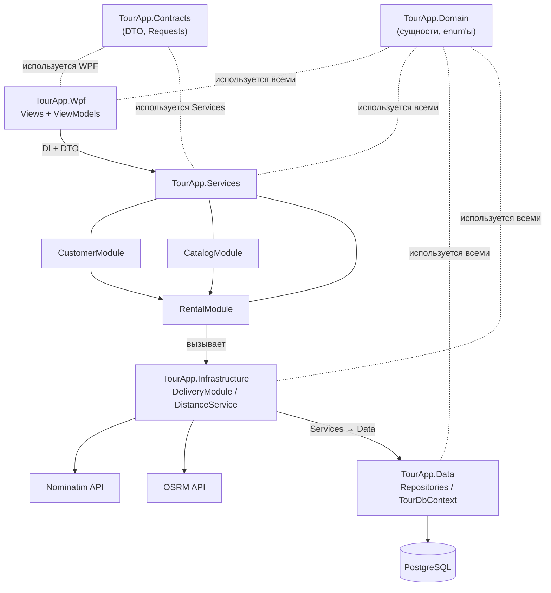
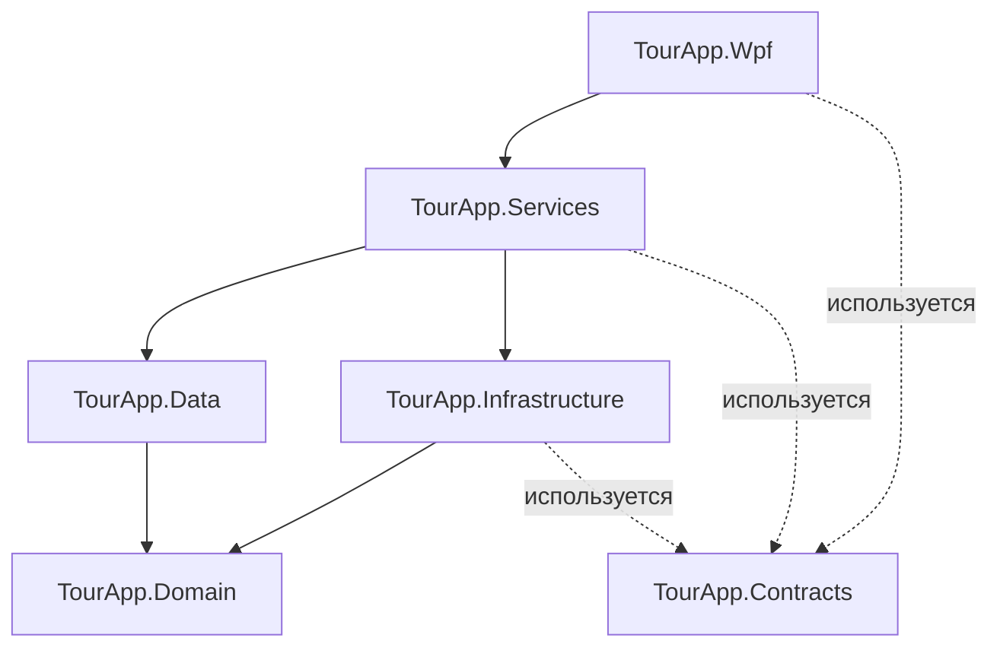
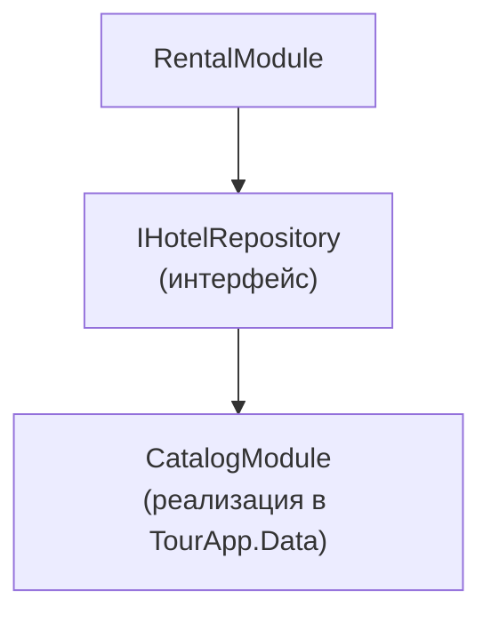
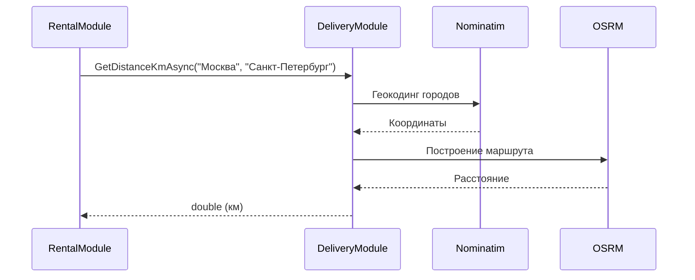
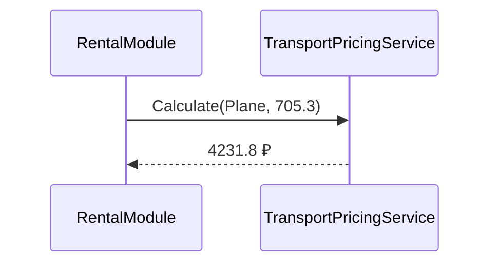
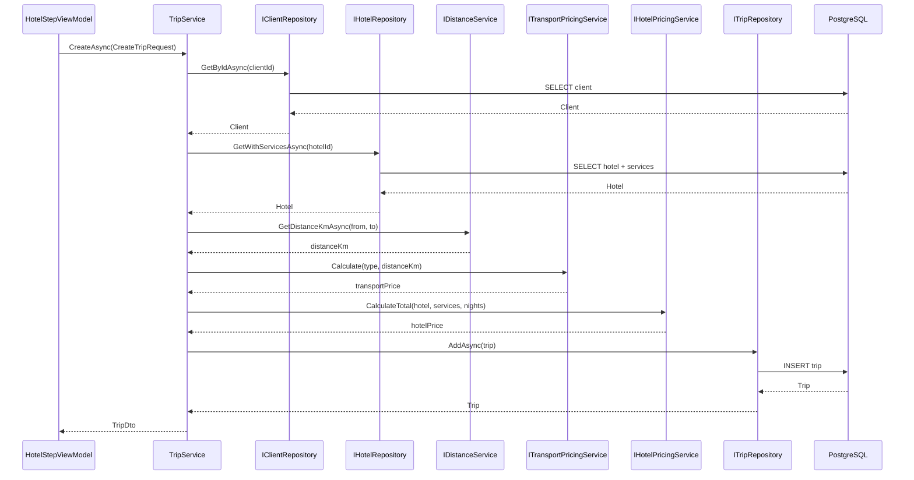
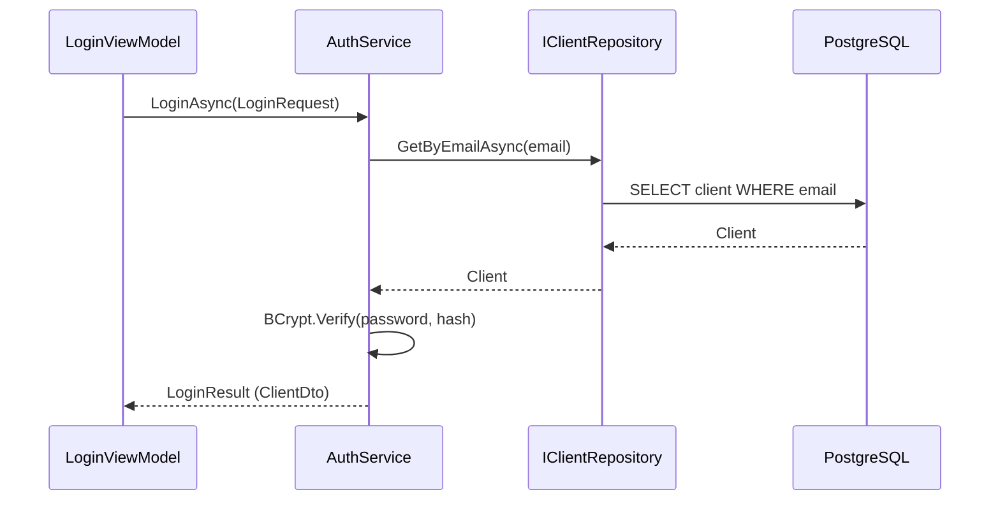
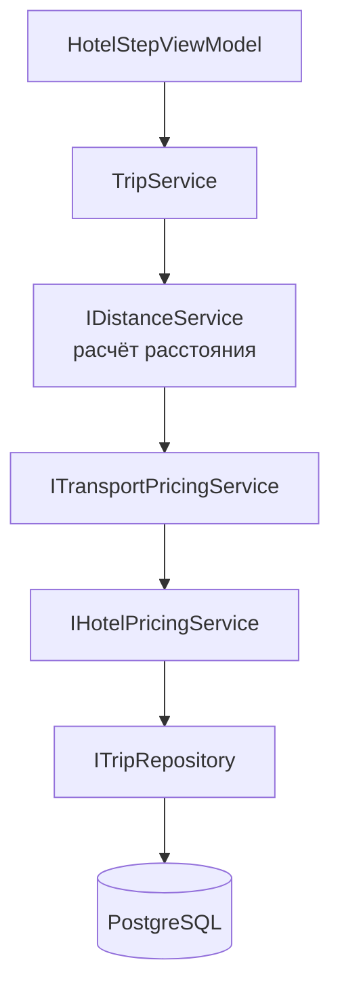

# Курсовое проектирование. Этап 1  
## Разработка перечня артефактов и протоколов проекта

**Тема курсового проекта:** «Разработка системы управления туристическим агентством»

**МДК:** 02.02 «Инструментальные средства разработки программного обеспечения»  
**Стек:** C# / .NET 9, Git  
**Тип приложения:** веб-приложение с серверной частью на ASP.NET Core

---

# 1. Исходное состояние проекта

Перед началом выполнения этапа был создан Git-репозиторий курсового проекта.

Исходное состояние было проверено командой:

```bash
git status
```

Текущая ветка:

```text
main
```

Для выполнения этапа создана отдельная ветка:

```bash
git checkout -b Docs/project-artifacts
```

В рамках данного этапа выполняется проектирование структуры программной системы и подготовка проектной документации.

---

# 2. Назначение и границы проекта

## 2.1. Назначение системы

Разрабатываемая программная система предназначена для автоматизации деятельности турагентства.

Пользователь системы должен иметь возможность:

- зарегистрироваться и войти в систему;
- указать паспортные данные и контактную информацию;
- указать способ оплаты;
- выбрать тип транспорта (самолёт, поезд, автобус, корабль);
- указать города отправления и назначения;
- получить расчёт расстояния между городами;
- получить расчёт стоимости поездки на транспорте;
- выбрать отель по количеству звёзд;
- выбрать дополнительные услуги отеля (питание, удобства, экскурсии);
- оформить и сохранить поездку;
- просматривать историю своих поездок.

Администратор должен иметь возможность:

- войти в систему под учётной записью администратора;
- просматривать список клиентов, редактировать и удалять;
- просматривать список отелей, редактировать и удалять;
- просматривать все поездки;
- экспортировать данные в CSV и Excel.

---

## 2.2. Основные объекты предметной области

В системе выделены следующие основные сущности:

- клиент;
- способ оплаты;
- рейс (транспорт);
- отель;
- услуга отеля;
- поездка;
- администратор.

Типы транспорта:

- самолёт;
- поезд;
- автобус;
- корабль.

Категории услуг отеля: 

- питание;
- удобства;
- экскурсии.

---

## 2.3. Границы проекта

### В систему входит

1. Регистрация и аутентификация клиентов.
2. Аутентификация администраторов.
3. Ведение каталога отелей и их услуг.
4. Ведение списка рейсов по типам транспорта.
5. Расчёт расстояния между городами через внешний сервис.
6. Расчёт стоимости поездки на транспорте.
7. Расчёт стоимости проживания с учётом выбранных услуг.
8. Оформление поездки.
9. Просмотр истории поездок клиента.
10. Экспорт данных в CSV и Excel.
11. Хранение информации о клиентах.

### В систему не входит

В рамках курсового проекта не реализуются:

- реальные банковские платежи;
- интеграция с платёжными шлюзами;
- хранение CVV и полных номеров карт;
- интеграция с внешними системами бронирования;
- отправка SMS и email;
- мобильное приложение;
- онлайн-оплата.

Эти функции могут быть добавлены при дальнейшем развитии проекта.

---

# 3. Реестр проектных артефактов

Для проекта сформирован следующий перечень артефактов.

| № | Артефакт | Назначение | Расположение |
|---:|---|---|---|
| 1 | Описание назначения и границ проекта | Определяет функции и ограничения системы | `docs/project-artifacts/project-scope.md` |
| 2 | Перечень модулей | Описывает состав системы и ответственность модулей | `docs/project-artifacts/modules.md` |
| 3 | Архитектурная схема | Показывает структуру и связи модулей | `docs/project-artifacts/architecture.md` |
| 4 | Перечень зависимостей | Фиксирует внутренние и внешние зависимости | `docs/project-artifacts/dependencies.md` |
| 5 | Контракты взаимодействия | Определяет правила обмена между модулями | `docs/project-artifacts/contracts.md` |
| 6 | DTO | Определяет структуры передаваемых данных | `src/TourApp.Contracts/` |
| 7 | Инструкция сборки и запуска | Позволяет другому разработчику запустить проект | `README.md` |
| 8 | Тестовая стратегия | Определяет порядок проверки системы | `docs/project-artifacts/testing.md` |
| 9 | Правила работы с Git | Определяет правила ветвления и коммитов | `docs/project-artifacts/version-control.md` |
| 10 | Журнал технических решений | Фиксирует значимые архитектурные решения | `docs/decisions/` |

---

# 4. Перечень модулей системы

В проекте выделено четыре основных функциональных модуля.

| Модуль | Ответственность |
|---|---|
| `CustomerModule` | Регистрация, аутентификация, хранение данных клиентов и способов оплаты |
| `CatalogModule` | Хранение информации об отелях, услугах и рейсах |
| `RentalModule` | Создание и управление поездками, расчёт стоимости |
| `DeliveryModule` | Расчёт расстояния между городами через внешний сервис |

---

## 4.1. CustomerModule

Отвечает за работу с клиентами.

- Основные функции:
- регистрация клиента с хешированием пароля (BCrypt);
- аутентификация клиента и администратора;
- получение и изменение данных клиента;
- хранение способов оплаты (маскированный номер, без CVV);
- просмотр истории поездок;
- проверка уникальности email.

Пример роли пользователя:

```text
Client
Admin
```

Пример состояния способа оплаты:

```text
Unverified
Verified
Expired
```
---

## 4.2. CatalogModule

Отвечает за каталог отелей и рейсов.

Основные функции:

- получение списка отелей;
- получение информации об отеле с услугами;
- получение списка рейсов по типу транспорта;
- изменение данных отеля и рейса;
- управление услугами отеля (питание, удобства, экскурсии);
- фильтрация отелей по количеству звёзд.

Пример категорий услуг отеля:

```text
Meal
Amenity
Excursion
```

Пример типов транспорта:

```text
Plane
Train
Bus
Ship
```

Пример категорий услуг отеля:

```text
ThreeStars
FourStars
FiveStars
```

---

## 4.3. RentalModule

Отвечает за оформление и управление поездками.

Основные функции:

- создание черновика поездки;
- расчёт стоимости транспорта;
- расчёт стоимости отеля с услугами;
- подтверждение поездки;
- отмена поездки;
- просмотр поездок клиента;
- проверка доступности услуг.

Пример состояний поездки:

```text
Draft
Confirmed
Paid
Cancelled
```

Модуль взаимодействует с:

```text
CustomerModule
CatalogModule
DeliveryModule
```

---

## 4.4. DeliveryModule

Отвечает за расчёт расстояния между городами

Основные функции:

- геокодинг городов через Nominatim;
- построение маршрута через OSRM;
- возврат расстояния в километрах;
- кэширование результатов;
- троттлинг запросов (1 запрос в секунду для Nominatim).

Пример результата:

```text
Москва → Санкт-Петербург = 705 км
```

Пример состояний запроса к внешнему сервису:

```text
Success
CityNotFound
ServiceUnavailable
```

---

# 5. Архитектурная схема

Для проекта выбрана модульная архитектура.



Центральным модулем бизнес-процесса является `RentalModule`.

При создании заказа он:

1. получает данные клиента из CustomerModule;
2. получает данные о рейсе (тип транспорта, города, дата) из CatalogModule;
3. получает данные об отеле и его услугах из CatalogModule;
4. рассчитывает расстояние между городами через DeliveryModule;
5. рассчитывает стоимость транспорта через ITransportPricingService;
6. рассчитывает стоимость отеля с учётом выбранных услуг через IHotelPricingService;
7. создаёт поездку и сохраняет её через ITripRepository в TourApp.Data.

---

# 6. Предполагаемая структура решения

```text
TourApp/
│
├── src/
│   │
│   ├── TourApp.Domain/          ← сущности (Model)
│   ├── TourApp.Contracts/       ← DTO, запросы, результаты, маппинг
│   ├── TourApp.Data/            ← EF Core, DbContext, репозитории
│   ├── TourApp.Services/        ← бизнес-логика
│   ├── TourApp.Infrastructure/  ← внешние API (Nominatim, OSRM)
│   └── TourApp.Wpf/             ← UI + ViewModels
│
├── tests/
│   │
│   ├── TourApp.UnitTests/
│   └── TourApp.IntegrationTests/
│
├── docs/
│   │
│   └── project-artifacts/
│       │
│       ├── project-scope.md
│       ├── modules.md
│       ├── architecture.md
│       ├── dependencies.md
│       ├── contracts.md
│       ├── testing.md
│       ├── version-control.md
│       │
│       └── decisions/
│           ├── ADR-001-layered-architecture.md
│           ├── ADR-002-mvvm.md
│           ├── ADR-003-ef-core.md
│           └── ADR-004-dto-layer.md
│
├── .gitignore
├── .editorconfig
├── README.md
└── TourApp.sln
```

---

# 7. Внутренние зависимости

Внутренние зависимости определяют взаимодействие проектов внутри решения.



При этом бизнес-модули не должны напрямую обращаться к внутренним классам друг друга.

Взаимодействие выполняется через публичные интерфейсы, зарегистрированные в DI.

Например, RentalModule получает данные об отеле для поездки:



Это позволяет уменьшить связанность модулей.

---

# 8. Внешние зависимости

На этапе проектирования предполагается использование следующих внешних компонентов.

| Зависимость | Версия | Назначение |
|---|---|---|
| .NET | 9.0 | Платформа выполнения |
| WPF | входит в .NET 9 | Клиентский интерфейс |
| Entity Framework Core | 9.0 | Доступ к данным |
| Npgsql.EntityFrameworkCore.PostgreSQL | 9.0 | Провайдер EF Core для PostgreSQL |
| PostgreSQL | 16+ | Хранение данных |
| CommunityToolkit.Mvvm | 8.3+ | MVVM без бойлерплейта |
| Microsoft.Extensions.Hosting | 9.0 | DI, конфигурация, логирование |
| MaterialDesignThemes | 5.x | Стили и темы WPF |
| BCrypt.Net-Next | 4.0+ | Хеширование паролей |
| Microsoft.Extensions.Http | 9.0 | IHttpClientFactory для внешних API |
| FluentValidation | 11.x | Валидация DTO |
| Nominatim (OpenStreetMap) | REST API | Внешний API геокодинга |
| OSRM | REST API | Внешний API маршрутизации |
| xUnit | 2.9+ | Модульное тестирование |
| Moq | 4.x | Мокирование в тестах |
| FluentAssertions | 6.x | Удобные assert'ы |
| Testcontainers.PostgreSql | 3.x | Интеграционные тесты на реальной БД |
| Git | 2.40+ | Контроль версий |

Конкретные версии библиотек фиксируются в файлах `.csproj`.

---

# 9. Основные DTO проекта

Для передачи данных между слоями и модулями создаются DTO.

## 9.1. ClientDto

```csharp
public record ClientDto(
    int Id,
    string Email,
    string FirstName,
    string LastName,
    string MiddleName,
    string Phone,
    bool IsAdmin
);
```

---

## 9.2. LoginRequest

```csharp
public record LoginRequest(
    string Email,
    string Password
);
```

---

## 9.3. RegisterRequest

```csharp
public record RegisterRequest(
    string Email,
    string Password
);
```

---

## 9.4. LoginResult

```csharp
public record LoginResult(
    bool Success,
    ClientDto? Client,
    string? ErrorCode
);
```

---

## 9.5. RegisterResult

```csharp
public record RegisterResult(
    bool Success,
    int? ClientId,
    string? ErrorCode
);
```

---

## 9.6. FlightDto

```csharp
public record FlightDto(
    Guid Id,
    string TransportType,
    string FromCity,
    string ToCity,
    decimal Price,
    DateTime DepartureTime
);
```

---

## 9.7. HotelDto

```csharp
public record HotelDto(
    Guid Id,
    string Name,
    int Stars,
    decimal BasePricePerNight,
    IReadOnlyList<HotelServiceDto> Services
);
```

---

## 9.8. HotelServiceDto

```csharp
public record HotelServiceDto(
    Guid Id,
    string Name,
    string Category,
    decimal Price
);
```

---

## 9.9. PaymentMethodDto

```csharp
public record PaymentMethodDto(
    int Id,
    string CardNumberMasked,
    string ExpiresAt
);
```

---

## 9.10. CreateTripRequest

```csharp
public record CreateTripRequest(
    int ClientId,
    string TransportType,
    string FromCity,
    string ToCity,
    DateTime DepartureDate,
    int Nights,
    Guid HotelId,
    IReadOnlyList<Guid> SelectedServiceIds
);
```

---

## 9.11. TripDto

```csharp
public record TripDto(
    Guid Id,
    int ClientId,
    string TransportType,
    string FromCity,
    string ToCity,
    decimal TransportPrice,
    decimal HotelPrice,
    decimal TotalPrice,
    DateTime DepartureDate,
    int Nights,
    string Status
);
```

---

## 9.12. CalculateDistanceRequest

```csharp
public record CalculateDistanceRequest(
    string FromCity,
    string ToCity
);
```

---

## 9.13. CalculateDistanceResult

```csharp
public record CalculateDistanceResult(
    bool Success,
    double? DistanceKm,
    string? ErrorCode
);
```

---

## 9.14. OperationResult

```csharp
public record OperationResult(
    bool Success,
    string? ErrorCode
);
```

---

## 9.15. UpdateClientRequest

```csharp
public record UpdateClientRequest(
    int Id,
    string FirstName,
    string LastName,
    string MiddleName,
    string Phone
);
```

---

## 9.16. UpdateHotelRequest

```csharp
public record UpdateHotelRequest(
    Guid Id,
    string Name,
    int Stars,
    decimal BasePricePerNight
);
```

---

# 10. Описание API

Клиентское приложение (WPF) не взаимодействует с системой через HTTP API. Серверная часть в проекте отсутствует: приложение настольное, все вызовы выполняются внутри процесса через интерфейсы, зарегистрированные в DI-контейнере.

Под «API» в проекте понимаются публичные интерфейсы слоёв `TourApp.Services` и `TourApp.Data`, а также внешние HTTP API (Nominatim и OSRM), которые вызывает `TourApp.Infrastructure`.

Предполагаются следующие основные точки взаимодействия.

| Метод | Интерфейс | Назначение |
|---|---|---|
| `LoginAsync` / `RegisterAsync` | `IAuthService` | Вход и регистрация клиента |
| `GetDistanceKmAsync` | `IDistanceService` | Расстояние между городами |
| `Calculate` | `ITransportPricingService` | Стоимость транспорта |
| `CalculateTotal` | `IHotelPricingService` | Стоимость отеля с услугами |
| `CreateAsync` / `CancelAsync` | `ITripService` | Создание и отмена поездки |
| `GetByEmailAsync` | `IClientRepository` | Получение клиента по email |
| `GetWithServicesAsync` | `IHotelRepository` | Отели с услугами |
| `FindAsync` | `IFlightRepository` | Поиск рейсов |
| `AddAsync` | `ITripRepository` | Сохранение поездки |

Внешние HTTP API, используемые проектом:

| Метод | Адрес | Назначение |
|---|---|---|
| `GET` | `https://nominatim.openstreetmap.org/search?q={city}&format=json` | Геокодинг города |
| `GET` | `https://router.project-osrm.org/route/v1/driving/{lon1},{lat1};{lon2},{lat2}?overview=false` | Расчёт маршрута |

---
# 11. Протокол взаимодействия № 1
## Расчёт расстояния между городами

### 11.1. Инициатор и получатель

**Инициатор:**

```text
RentalModule
```

**Получатель:**

```text
DeliveryModule
```

### 11.2. Назначение
Протокол используется при расчёте стоимости транспорта. Для корректной цены необходимо знать расстояние между городами отправления и назначения.

### 11.3. Механизм вызова
Асинхронный вызов через интерфейс C#:

```csharp
IDistanceService
```

Зависимость передаётся через механизм Dependency Injection.

### 11.4. Точка входа

```csharp
Task<double> GetDistanceKmAsync(
    string fromCity,
    string toCity,
    CancellationToken cancellationToken);
```

### 11.5. Формат запроса

```json
{
  "fromCity": "Москва",
  "toCity": "Санкт-Петербург"
}
```

### 11.6. Успешный ответ

```json
{
  "success": true,
  "distanceKm": 705.3,
  "errorCode": null
}
```

### 11.7. Ошибки

| Код | Описание |
|-----|----------|
| CITY_NOT_FOUND | Город не найден |
| DISTANCE_SERVICE_UNAVAILABLE | Внешний сервис недоступен |
| INVALID_CITY_NAME | Некорректное название города |

Пример:

```json
{
  "success": false,
  "distanceKm": null,
  "errorCode": "CITY_NOT_FOUND"
}
```

### 11.8. Таймаут
Операция должна завершиться не более чем за:

```text
15 секунд
```

При отмене запроса используется CancellationToken.

### 11.9. Повторная отправка
Автоматический повтор операции не выполняется.

Причина: Nominatim имеет лимит 1 запрос в секунду, OSRM может вернуть разные данные при повторных вызовах.

Повтор операции выполняется только после проверки результата предыдущего вызова.

### 11.10. Аутентификация
Дополнительная аутентификация не выполняется.

### 11.11. Версия контракта

```text
DistanceContract v1
```

### 11.12. Пример обмена



# 12. Протокол взаимодействия № 2
## Расчёт стоимости транспорта

### 12.1. Инициатор и получатель

**Инициатор:**

```text
RentalModule
```

**Получатель:**

```text
Services / TransportPricingService
```

### 12.2. Назначение
После получения расстояния необходимо рассчитать стоимость поездки в зависимости от типа транспорта.

### 12.3. Механизм вызова
Синхронный вызов через интерфейс:

```csharp
ITransportPricingService
```

### 12.4. Точка входа

```csharp
decimal Calculate(TransportType type, double distanceKm);
```

### 12.5. Правила расчёта

| Тип | Порог (км) | Цена за км до порога | Цена за км после порога |
|-----|-----------|----------------------|-------------------------|
| Самолёт | 2000 | 6.0 | 4.5 |
| Поезд | 2000 | 2.5 | 1.5 |
| Автобус | 3000 | 4.0 | 4.0 |
| Корабль | 2000 | 4.0 | 3.5 |

### 12.6. Пример обмена



### 12.7. Ошибки

| Код | Описание |
|-----|----------|
| UNKNOWN_TRANSPORT_TYPE | Неизвестный тип транспорта |
| INVALID_DISTANCE | Отрицательное расстояние |

### 12.8. Версия контракта

```text
TransportPricingContract v1
```

---

# 13. Протокол взаимодействия № 3
## Создание поездки

### 13.1. Инициатор и получатель

**Инициатор:**

```text
HotelStepViewModel (UI)
```

**Получатель:**

```text
Services / TripService
```

### 13.2. Назначение
Протокол используется при финальном сохранении поездки после прохождения всех шагов мастера.

### 13.3. Механизм вызова
Асинхронный вызов через интерфейс:

```csharp
ITripService
```

### 13.4. Точка входа

```csharp
Task<TripDto> CreateAsync(CreateTripRequest request, CancellationToken ct = default);
```

### 13.5. Формат запроса

```json
{
  "clientId": 1,
  "transportType": "Plane",
  "fromCity": "Москва",
  "toCity": "Санкт-Петербург",
  "departureDate": "2026-11-01T10:00:00",
  "nights": 3,
  "hotelId": "8939af05-2a59-4758-a263-75df01c6d3f0",
  "selectedServiceIds": [
    "4f7fb20d-b92c-4082-a031-7eb643216a18",
    "5a8fc31e-a03d-4193-b142-8fc754327b29"
  ]
}
```

### 13.6. Успешный ответ

```json
{
  "id": "8b2c1d4e-...-...",
  "clientId": 1,
  "transportType": "Plane",
  "fromCity": "Москва",
  "toCity": "Санкт-Петербург",
  "transportPrice": 4231.8,
  "hotelPrice": 15000.0,
  "totalPrice": 19231.8,
  "departureDate": "2026-11-01T10:00:00",
  "nights": 3,
  "status": "Confirmed"
}
```

### 13.7. Ошибки

| Код | Описание |
|-----|----------|
| CLIENT_NOT_FOUND | Клиент не найден |
| HOTEL_NOT_FOUND | Отель не найден |
| INVALID_NIGHTS | Некорректное количество ночей |
| INVALID_DEPARTURE_DATE | Дата в прошлом |
| DISTANCE_SERVICE_UNAVAILABLE | Внешний сервис недоступен |

Пример ошибки:

```json
{
  "success": false,
  "errorCode": "CLIENT_NOT_FOUND"
}
```

### 13.8. Таймаут
20 секунд (включает расчёт расстояния). При отмене — CancellationToken.

### 13.9. Повторная отправка
Не выполняется автоматически. Повторный вызов создаст новую поездку.

### 13.10. Транзакция
Операция должна выполняться в транзакции. Если расчёт расстояния или сохранение падает — откат.

### 13.11. Версия контракта

```text
TripContract v1
```

### 13.12. Пример обмена



---

# 14. Протокол взаимодействия № 4
## Аутентификация клиента

### 14.1. Инициатор и получатель

**Инициатор:**

```text
LoginViewModel
```

**Получатель:**

```text
CustomerModule / AuthService
```

### 14.2. Назначение
Проверка подлинности пользователя и получение данных клиента для последующих операций.

### 14.3. Механизм вызова
Асинхронный вызов через интерфейс:

```csharp
IAuthService
```

### 14.4. Точка входа

```csharp
Task<LoginResult> LoginAsync(LoginRequest request, CancellationToken ct = default);
```

### 14.5. Формат запроса

```json
{
  "email": "user@example.com",
  "password": "secret123"
}
```

### 14.6. Успешный ответ

```json
{
  "success": true,
  "client": {
    "id": 1,
    "email": "user@example.com",
    "firstName": "Иван",
    "lastName": "Иванов",
    "middleName": "Иванович",
    "phone": "+79001234567",
    "isAdmin": false
  },
  "errorCode": null
}
```

### 14.7. Ошибки

| Код | Описание |
|-----|----------|
| INVALID_CREDENTIALS | Неверный email или пароль |
| EMAIL_NOT_FOUND | Email не зарегистрирован |
| CLIENT_BLOCKED | Учётная запись заблокирована |

Пример:

```json
{
  "success": false,
  "client": null,
  "errorCode": "INVALID_CREDENTIALS"
}
```

### 14.8. Таймаут
5 секунд.

### 14.9. Повторная отправка
Разрешена. Каждый вызов — независимая проверка.

### 14.10. Безопасность
Пароль передаётся только в открытом виде внутри приложения, никогда не логируется.

Хранится только PasswordHash (BCrypt).

Проверка PasswordHash выполняется через BCrypt.Verify.

### 14.11. Версия контракта

```text
AuthContract v1
```

### 14.12. Пример обмена



---

# 15. Тестовая стратегия

Для проекта предусматриваются три уровня проверки.

## 15.1. Модульные тесты

Модульные тесты должны проверять отдельные правила предметной области.

Примеры:

### Тест 1

Регистрация нового клиента с уникальным email.

**Ожидаемый результат:** клиент создан, пароль захеширован.

### Тест 2

Регистрация с уже существующим email.

**Ожидаемый результат:**

```text
EMAIL_ALREADY_EXISTS
```

### Тест 3

Расчёт стоимости транспорта для самолёта при расстоянии 1500 км.

**Ожидаемый результат:** 9000 ₽ (1500 × 6.0).

### Тест 4

Расчёт стоимости транспорта для поезда при расстоянии 2500 км.

**Ожидаемый результат:** 3750 ₽ (2500 × 1.5).

### Тест 5

Расчёт стоимости транспорта для автобуса при расстоянии 3500 км.

**Ожидаемый результат:** 14000 ₽ (3500 × 4.0).

### Тест 6

Расчёт стоимости отеля 4★ на 3 ночи с завтраком и бассейном.

**Ожидаемый результат:** базовая цена × 3 + услуги.

### Тест 7

Отрицательное расстояние.

**Ожидаемый результат:**

```text
INVALID_DISTANCE
```

### Тест 8

Неизвестный тип транспорта.

**Ожидаемый результат:**

```text
UNKNOWN_TRANSPORT_TYPE
```

## 15.2. Интеграционные тесты

Интеграционные тесты должны проверять взаимодействие слоёв и модулей.

### Сценарий 1. Успешное оформление поездки



Ожидается:

- расстояние рассчитано;
- стоимость транспорта посчитана;
- стоимость отеля посчитана;
- поездка сохранена.

### Сценарий 2. Внешний сервис недоступен

Ожидается:

- операция прервана;
- поездка не создана;
- пользователь получает сообщение об ошибке.

### Сценарий 3. Логин существующего клиента

Ожидается:

- `LoginResult.Success = true`;
- `ClientDto` заполнен.

### Сценарий 4. Логин с неверным паролем

Ожидается:

- `LoginResult.Success = false`;
- `errorCode = INVALID_CREDENTIALS`.

## 15.3. Проверка сборки

После внесения изменений должны выполняться:

```bash
dotnet build
dotnet test
```

Критерием успешного результата является отсутствие ошибок сборки и прохождение всех автоматических тестов.

---

# 16. Правила ведения репозитория

Для проекта используются следующие основные ветки:

```text
main
develop
feature/*
fix/*
docs/*
```

## main

Содержит стабильную версию проекта.

## develop

Используется для объединения результатов разработки.

## feature/*

Используется для разработки новых функций.

Примеры:

```text
feature/client-auth
feature/transport-selection
feature/hotel-selection
feature/trip-creation
```

## fix/*

Используется для исправления дефектов.

Например:

```text
fix/distance-service-timeout
fix/password-hashing
```

## docs/*

Используется при значительных изменениях документации.

Например:

```text
docs/project-artifacts
```

---

# 17. Правила коммитов

Один коммит должен содержать одно логически завершённое изменение.

Используются следующие обозначения:

```text
feat: новая функциональность
fix: исправление
docs: документация
test: тесты
refactor: изменение структуры кода
chore: техническое изменение
```

Примеры:

```text
docs: add project scope
docs: add architecture diagram
docs: describe service contracts
feat: add client DTOs
feat: add distance calculation service
test: add transport pricing tests
```

Не допускаются малоинформативные сообщения:

```text
update
fix
work
123
изменения
```

---

# 18. Журнал технических решений

Для значимых решений проекта используется каталог:

```text
docs/project-artifacts/decisions/
```

Каждое решение оформляется отдельным документом.

## ADR-001. Использование слоистой архитектуры

### Статус

Принято.

### Проблема

Необходимо разделить функции системы так, чтобы изменение работы с данными не влияло на UI, а изменение UI не влияло на бизнес-логику.

### Решение

Разделить приложение на слои:

```text
Domain
Contracts
Data
Services
Infrastructure
Wpf
```

### Причина

Такое разделение позволяет:

- определить ответственность компонентов;
- уменьшить связанность;
- независимо тестировать бизнес-логику;
- упростить последующее расширение проекта.

## ADR-002. Использование MVVM в WPF

### Статус

Принято.

### Проблема

В WinForms логика приложения была тесно связана с формами, что затрудняло тестирование и переиспользование кода.

### Решение

Использовать паттерн MVVM:

- Model — доменные сущности;
- ViewModel — состояние экрана и команды;
- View — XAML-разметка без логики.

### Последствия

Положительные:

- ViewModel тестируется без UI;
- логика отделена от разметки;
- используется CommunityToolkit.Mvvm.

Отрицательные:

- необходимость освоить привязки и команды;
- выше порог входа.

## ADR-003. Использование слоя DTO

### Статус

Принято.

### Проблема

Прямая передача доменных сущностей между слоями приводит к:

- утечке чувствительных полей (PasswordHash);
- циклическим ссылкам при сериализации;
- сильной связанности UI и БД;
- невозможности менять модель без перекомпиляции UI.

### Решение

Ввести отдельный проект TourApp.Contracts с DTO:

- DTO запросов (CreateTripRequest, LoginRequest);
- DTO ответов (TripDto, ClientDto);
- DTO результатов (OperationResult, RegisterResult);
- extension-методы маппинга Model ↔ DTO.

### Последствия

Положительные:

- UI не зависит от Model;
- чувствительные поля не утекают;
- контракты стабильны;
- проще тестировать сервисы.

Отрицательные:

- дополнительный проект и код;
- ручной маппинг.

---

# 19. Проверка выполнения этапа

После подготовки проектных артефактов была выполнена самопроверка.

| Требование | Результат |
|-----------|-----------|
| Описано назначение проекта | Выполнено |
| Определены границы проекта | Выполнено |
| Выделены модули | Выполнено |
| Описана ответственность модулей | Выполнено |
| Подготовлена архитектурная схема | Выполнено |
| Определены внутренние зависимости | Выполнено |
| Определены внешние зависимости | Выполнено |
| Описаны сервисы | Выполнено |
| Созданы модели DTO | Выполнено |
| Описаны минимум два протокола | Выполнено (четыре) |
| Подготовлена инструкция запуска | Выполнено |
| Подготовлена тестовая стратегия | Выполнено |
| Определены правила Git | Выполнено |
| Создан журнал технических решений | Выполнено |

---

