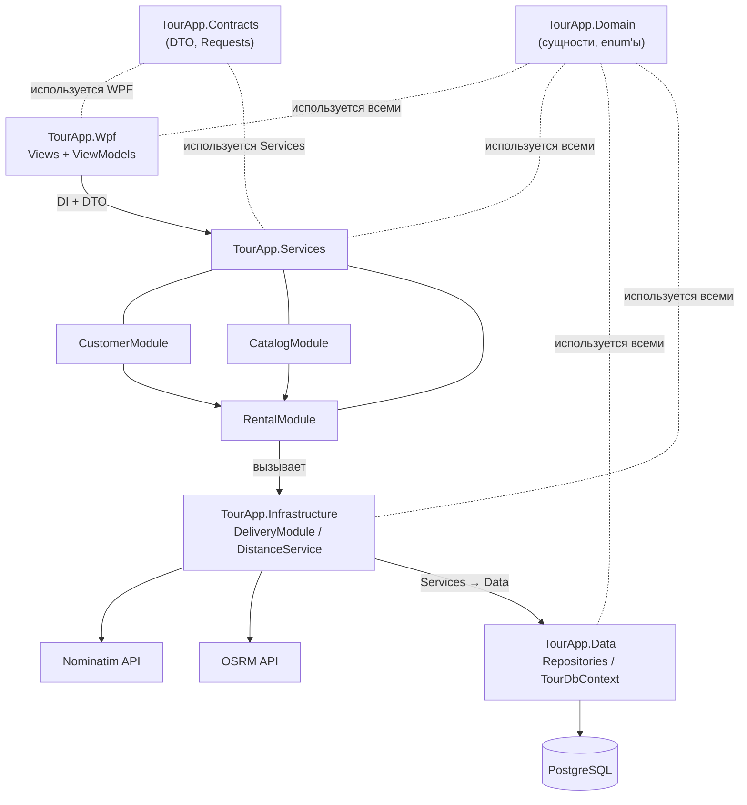

# 5. Архитектурная схема

Для проекта выбрана модульная архитектура.

Центральным модулем бизнес-процесса является `RentalModule`.

При создании заказа он:

1. получает данные клиента из CustomerModule;
2. получает данные о рейсе (тип транспорта, города, дата) из CatalogModule;
3. получает данные об отеле и его услугах из CatalogModule;
4. рассчитывает расстояние между городами через DeliveryModule;
5. рассчитывает стоимость транспорта через ITransportPricingService;
6. рассчитывает стоимость отеля с учётом выбранных услуг через IHotelPricingService;
7. создаёт поездку и сохраняет её через ITripRepository в TourApp.Data

---
