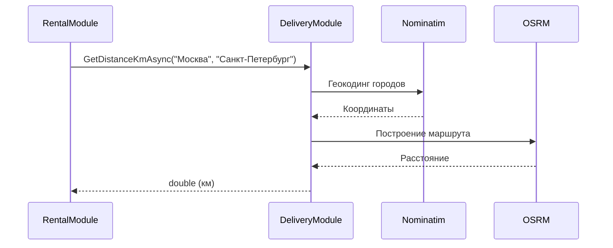
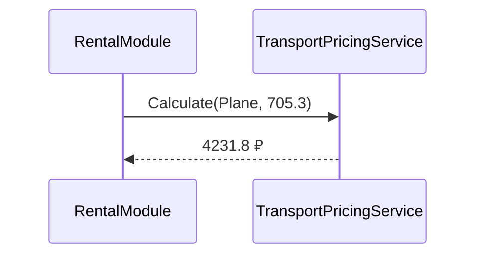
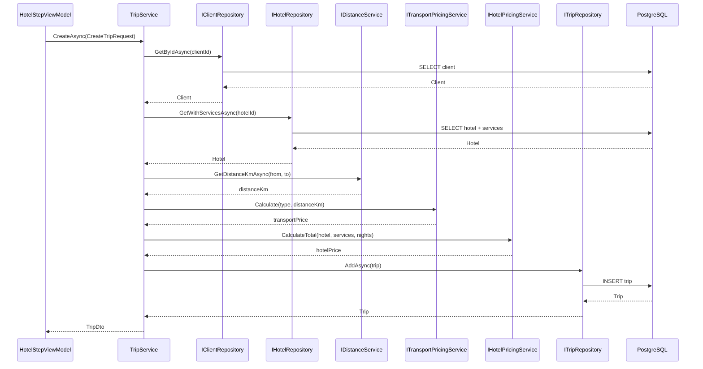
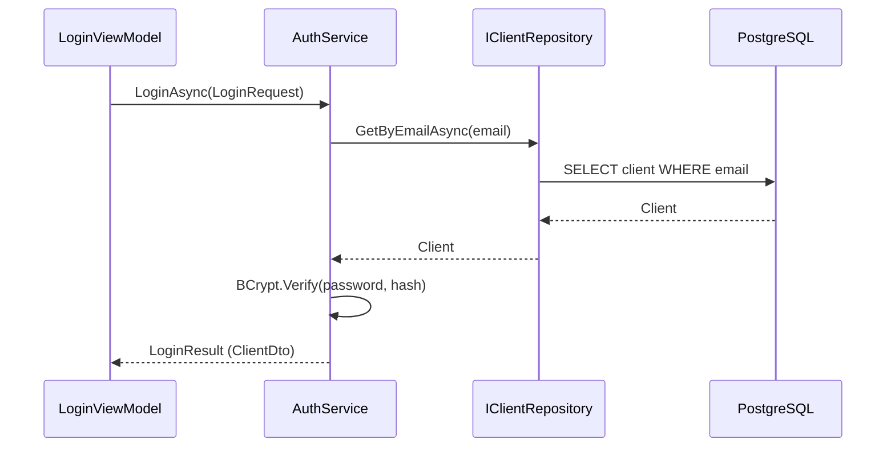

# Контракты взаимодействия

# 9. Основные DTO проекта

Для передачи данных между слоями и модулями создаются DTO.

## 9.1. ClientDto

```csharp
public record ClientDto(
    int Id,
    string Email,
    string FirstName,
    string LastName,
    string MiddleName,
    string Phone,
    bool IsAdmin
);
```

---

## 9.2. LoginRequest

```csharp
public record LoginRequest(
    string Email,
    string Password
);
```

---

## 9.3. RegisterRequest

```csharp
public record RegisterRequest(
    string Email,
    string Password
);
```

---

## 9.4. LoginResult

```csharp
public record LoginResult(
    bool Success,
    ClientDto? Client,
    string? ErrorCode
);
```

---

## 9.5. RegisterResult

```csharp
public record RegisterResult(
    bool Success,
    int? ClientId,
    string? ErrorCode
);
```

---

## 9.6. FlightDto

```csharp
public record FlightDto(
    Guid Id,
    string TransportType,
    string FromCity,
    string ToCity,
    decimal Price,
    DateTime DepartureTime
);
```

---

## 9.7. HotelDto

```csharp
public record HotelDto(
    Guid Id,
    string Name,
    int Stars,
    decimal BasePricePerNight,
    IReadOnlyList<HotelServiceDto> Services
);
```

---

## 9.8. HotelServiceDto

```csharp
public record HotelServiceDto(
    Guid Id,
    string Name,
    string Category,
    decimal Price
);
```

---

## 9.9. PaymentMethodDto

```csharp
public record PaymentMethodDto(
    int Id,
    string CardNumberMasked,
    string ExpiresAt
);
```

---

## 9.10. CreateTripRequest

```csharp
public record CreateTripRequest(
    int ClientId,
    string TransportType,
    string FromCity,
    string ToCity,
    DateTime DepartureDate,
    int Nights,
    Guid HotelId,
    IReadOnlyList<Guid> SelectedServiceIds
);
```

---

## 9.11. TripDto

```csharp
public record TripDto(
    Guid Id,
    int ClientId,
    string TransportType,
    string FromCity,
    string ToCity,
    decimal TransportPrice,
    decimal HotelPrice,
    decimal TotalPrice,
    DateTime DepartureDate,
    int Nights,
    string Status
);
```

---

## 9.12. CalculateDistanceRequest

```csharp
public record CalculateDistanceRequest(
    string FromCity,
    string ToCity
);
```

---

## 9.13. CalculateDistanceResult

```csharp
public record CalculateDistanceResult(
    bool Success,
    double? DistanceKm,
    string? ErrorCode
);
```

---

## 9.14. OperationResult

```csharp
public record OperationResult(
    bool Success,
    string? ErrorCode
);
```

---

## 9.15. UpdateClientRequest

```csharp
public record UpdateClientRequest(
    int Id,
    string FirstName,
    string LastName,
    string MiddleName,
    string Phone
);
```

---

## 9.16. UpdateHotelRequest

```csharp
public record UpdateHotelRequest(
    Guid Id,
    string Name,
    int Stars,
    decimal BasePricePerNight
);
```

---

# 10. Описание API

Клиентское приложение (WPF) не взаимодействует с системой через HTTP API. Серверная часть в проекте отсутствует: приложение настольное, все вызовы выполняются внутри процесса через интерфейсы, зарегистрированные в DI-контейнере.

Под «API» в проекте понимаются публичные интерфейсы слоёв `TourApp.Services` и `TourApp.Data`, а также внешние HTTP API (Nominatim и OSRM), которые вызывает `TourApp.Infrastructure`.

Предполагаются следующие основные точки взаимодействия.

| Метод | Интерфейс | Назначение |
|---|---|---|
| `LoginAsync` / `RegisterAsync` | `IAuthService` | Вход и регистрация клиента |
| `GetDistanceKmAsync` | `IDistanceService` | Расстояние между городами |
| `Calculate` | `ITransportPricingService` | Стоимость транспорта |
| `CalculateTotal` | `IHotelPricingService` | Стоимость отеля с услугами |
| `CreateAsync` / `CancelAsync` | `ITripService` | Создание и отмена поездки |
| `GetByEmailAsync` | `IClientRepository` | Получение клиента по email |
| `GetWithServicesAsync` | `IHotelRepository` | Отели с услугами |
| `FindAsync` | `IFlightRepository` | Поиск рейсов |
| `AddAsync` | `ITripRepository` | Сохранение поездки |

Внешние HTTP API, используемые проектом:

| Метод | Адрес | Назначение |
|---|---|---|
| `GET` | `https://nominatim.openstreetmap.org/search?q={city}&format=json` | Геокодинг города |
| `GET` | `https://router.project-osrm.org/route/v1/driving/{lon1},{lat1};{lon2},{lat2}?overview=false` | Расчёт маршрута |

---
# 11. Протокол взаимодействия № 1
## Расчёт расстояния между городами

### 11.1. Инициатор и получатель

**Инициатор:**

```text
RentalModule
```

**Получатель:**

```text
DeliveryModule
```

### 11.2. Назначение
Протокол используется при расчёте стоимости транспорта. Для корректной цены необходимо знать расстояние между городами отправления и назначения.

### 11.3. Механизм вызова
Асинхронный вызов через интерфейс C#:

```csharp
IDistanceService
```

Зависимость передаётся через механизм Dependency Injection.

### 11.4. Точка входа

```csharp
Task<double> GetDistanceKmAsync(
    string fromCity,
    string toCity,
    CancellationToken cancellationToken);
```

### 11.5. Формат запроса

```json
{
  "fromCity": "Москва",
  "toCity": "Санкт-Петербург"
}
```

### 11.6. Успешный ответ

```json
{
  "success": true,
  "distanceKm": 705.3,
  "errorCode": null
}
```

### 11.7. Ошибки

| Код | Описание |
|-----|----------|
| CITY_NOT_FOUND | Город не найден |
| DISTANCE_SERVICE_UNAVAILABLE | Внешний сервис недоступен |
| INVALID_CITY_NAME | Некорректное название города |

Пример:

```json
{
  "success": false,
  "distanceKm": null,
  "errorCode": "CITY_NOT_FOUND"
}
```

### 11.8. Таймаут
Операция должна завершиться не более чем за:

```text
15 секунд
```

При отмене запроса используется CancellationToken.

### 11.9. Повторная отправка
Автоматический повтор операции не выполняется.

Причина: Nominatim имеет лимит 1 запрос в секунду, OSRM может вернуть разные данные при повторных вызовах.

Повтор операции выполняется только после проверки результата предыдущего вызова.

### 11.10. Аутентификация
Дополнительная аутентификация не выполняется.

### 11.11. Версия контракта

```text
DistanceContract v1
```

### 11.12. Пример обмена



# 12. Протокол взаимодействия № 2
## Расчёт стоимости транспорта

### 12.1. Инициатор и получатель

**Инициатор:**

```text
RentalModule
```

**Получатель:**

```text
Services / TransportPricingService
```

### 12.2. Назначение
После получения расстояния необходимо рассчитать стоимость поездки в зависимости от типа транспорта.

### 12.3. Механизм вызова
Синхронный вызов через интерфейс:

```csharp
ITransportPricingService
```

### 12.4. Точка входа

```csharp
decimal Calculate(TransportType type, double distanceKm);
```

### 12.5. Правила расчёта

| Тип | Порог (км) | Цена за км до порога | Цена за км после порога |
|-----|-----------|----------------------|-------------------------|
| Самолёт | 2000 | 6.0 | 4.5 |
| Поезд | 2000 | 2.5 | 1.5 |
| Автобус | 3000 | 4.0 | 4.0 |
| Корабль | 2000 | 4.0 | 3.5 |

### 12.6. Пример обмена



### 12.7. Ошибки

| Код | Описание |
|-----|----------|
| UNKNOWN_TRANSPORT_TYPE | Неизвестный тип транспорта |
| INVALID_DISTANCE | Отрицательное расстояние |

### 12.8. Версия контракта

```text
TransportPricingContract v1
```

---

# 13. Протокол взаимодействия № 3
## Создание поездки

### 13.1. Инициатор и получатель

**Инициатор:**

```text
HotelStepViewModel (UI)
```

**Получатель:**

```text
Services / TripService
```

### 13.2. Назначение
Протокол используется при финальном сохранении поездки после прохождения всех шагов мастера.

### 13.3. Механизм вызова
Асинхронный вызов через интерфейс:

```csharp
ITripService
```

### 13.4. Точка входа

```csharp
Task<TripDto> CreateAsync(CreateTripRequest request, CancellationToken ct = default);
```

### 13.5. Формат запроса

```json
{
  "clientId": 1,
  "transportType": "Plane",
  "fromCity": "Москва",
  "toCity": "Санкт-Петербург",
  "departureDate": "2026-11-01T10:00:00",
  "nights": 3,
  "hotelId": "8939af05-2a59-4758-a263-75df01c6d3f0",
  "selectedServiceIds": [
    "4f7fb20d-b92c-4082-a031-7eb643216a18",
    "5a8fc31e-a03d-4193-b142-8fc754327b29"
  ]
}
```

### 13.6. Успешный ответ

```json
{
  "id": "8b2c1d4e-...-...",
  "clientId": 1,
  "transportType": "Plane",
  "fromCity": "Москва",
  "toCity": "Санкт-Петербург",
  "transportPrice": 4231.8,
  "hotelPrice": 15000.0,
  "totalPrice": 19231.8,
  "departureDate": "2026-11-01T10:00:00",
  "nights": 3,
  "status": "Confirmed"
}
```

### 13.7. Ошибки

| Код | Описание |
|-----|----------|
| CLIENT_NOT_FOUND | Клиент не найден |
| HOTEL_NOT_FOUND | Отель не найден |
| INVALID_NIGHTS | Некорректное количество ночей |
| INVALID_DEPARTURE_DATE | Дата в прошлом |
| DISTANCE_SERVICE_UNAVAILABLE | Внешний сервис недоступен |

Пример ошибки:

```json
{
  "success": false,
  "errorCode": "CLIENT_NOT_FOUND"
}
```

### 13.8. Таймаут
20 секунд (включает расчёт расстояния). При отмене — CancellationToken.

### 13.9. Повторная отправка
Не выполняется автоматически. Повторный вызов создаст новую поездку.

### 13.10. Транзакция
Операция должна выполняться в транзакции. Если расчёт расстояния или сохранение падает — откат.

### 13.11. Версия контракта

```text
TripContract v1
```

### 13.12. Пример обмена



---

# 14. Протокол взаимодействия № 4
## Аутентификация клиента

### 14.1. Инициатор и получатель

**Инициатор:**

```text
LoginViewModel
```

**Получатель:**

```text
CustomerModule / AuthService
```

### 14.2. Назначение
Проверка подлинности пользователя и получение данных клиента для последующих операций.

### 14.3. Механизм вызова
Асинхронный вызов через интерфейс:

```csharp
IAuthService
```

### 14.4. Точка входа

```csharp
Task<LoginResult> LoginAsync(LoginRequest request, CancellationToken ct = default);
```

### 14.5. Формат запроса

```json
{
  "email": "user@example.com",
  "password": "secret123"
}
```

### 14.6. Успешный ответ

```json
{
  "success": true,
  "client": {
    "id": 1,
    "email": "user@example.com",
    "firstName": "Иван",
    "lastName": "Иванов",
    "middleName": "Иванович",
    "phone": "+79001234567",
    "isAdmin": false
  },
  "errorCode": null
}
```

### 14.7. Ошибки

| Код | Описание |
|-----|----------|
| INVALID_CREDENTIALS | Неверный email или пароль |
| EMAIL_NOT_FOUND | Email не зарегистрирован |
| CLIENT_BLOCKED | Учётная запись заблокирована |

Пример:

```json
{
  "success": false,
  "client": null,
  "errorCode": "INVALID_CREDENTIALS"
}
```

### 14.8. Таймаут
5 секунд.

### 14.9. Повторная отправка
Разрешена. Каждый вызов — независимая проверка.

### 14.10. Безопасность
Пароль передаётся только в открытом виде внутри приложения, никогда не логируется.

Хранится только PasswordHash (BCrypt).

Проверка PasswordHash выполняется через BCrypt.Verify.

### 14.11. Версия контракта

```text
AuthContract v1
```

### 14.12. Пример обмена

