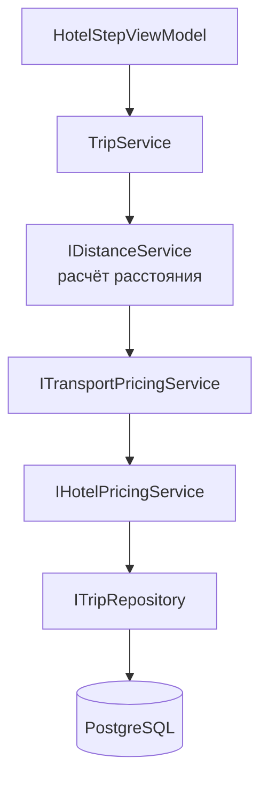

# 15. Тестовая стратегия

Для проекта предусматриваются три уровня проверки.

## 15.1. Модульные тесты

Модульные тесты должны проверять отдельные правила предметной области.

Примеры:

### Тест 1

Регистрация нового клиента с уникальным email.

**Ожидаемый результат:** клиент создан, пароль захеширован.

### Тест 2

Регистрация с уже существующим email.

**Ожидаемый результат:**

```text
EMAIL_ALREADY_EXISTS
```

### Тест 3

Расчёт стоимости транспорта для самолёта при расстоянии 1500 км.

**Ожидаемый результат:** 9000 ₽ (1500 × 6.0).

### Тест 4

Расчёт стоимости транспорта для поезда при расстоянии 2500 км.

**Ожидаемый результат:** 3750 ₽ (2500 × 1.5).

### Тест 5

Расчёт стоимости транспорта для автобуса при расстоянии 3500 км.

**Ожидаемый результат:** 14000 ₽ (3500 × 4.0).

### Тест 6

Расчёт стоимости отеля 4★ на 3 ночи с завтраком и бассейном.

**Ожидаемый результат:** базовая цена × 3 + услуги.

### Тест 7

Отрицательное расстояние.

**Ожидаемый результат:**

```text
INVALID_DISTANCE
```

### Тест 8

Неизвестный тип транспорта.

**Ожидаемый результат:**

```text
UNKNOWN_TRANSPORT_TYPE
```

## 15.2. Интеграционные тесты

Интеграционные тесты должны проверять взаимодействие слоёв и модулей.

### Сценарий 1. Успешное оформление поездки



Ожидается:

- расстояние рассчитано;
- стоимость транспорта посчитана;
- стоимость отеля посчитана;
- поездка сохранена.

### Сценарий 2. Внешний сервис недоступен

Ожидается:

- операция прервана;
- поездка не создана;
- пользователь получает сообщение об ошибке.

### Сценарий 3. Логин существующего клиента

Ожидается:

- `LoginResult.Success = true`;
- `ClientDto` заполнен.

### Сценарий 4. Логин с неверным паролем

Ожидается:

- `LoginResult.Success = false`;
- `errorCode = INVALID_CREDENTIALS`.

## 15.3. Проверка сборки

После внесения изменений должны выполняться:

```bash
dotnet build
dotnet test
```

Критерием успешного результата является отсутствие ошибок сборки и прохождение всех автоматических тестов.